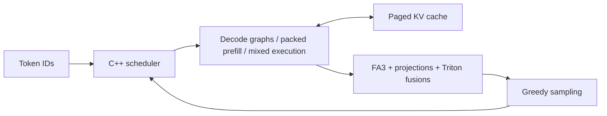

# Qwen-frence

A model-specific inference engine for **Qwen2.5-1.5B on one H100**, built to study scheduling, CUDA graphs, and kernel fusion.

The engine combines a C++ continuous-batching scheduler, paged KV storage, packed prefill/mixed execution, and Triton fusions. Attention uses **external FlashAttention-3 through vLLM**.

## Results at a glance

Against vLLM 0.30.0 on eight fixed FP16, greedy-decoding workloads:

| Measurement | Result |
|---|---:|
| Burst throughput, geometric-mean speedup | **1.029×** |
| Two-wave mixed throughput, geometric-mean speedup | **0.999×** |
| Synchronized decode-step speedup | **1.22–1.39×** |
| Identical complete output sequences | **571 / 576** |

One warmup and three measured runs per engine and workload. Decode steps are a separate synchronized diagnostic. The five sequence mismatches remain to be numerically explained.

[Full results and methodology](docs/results.md) · [Raw measurements](experiments/results/final-accepted-8192/summary.json)

## Execution

The accepted configuration uses decode CUDA graphs, piecewise prefill graphs, packed QKV/gate-up projections, RoPE/KV-write fusion, residual RMSNorm, and conditional SwiGLU. Experimental options stay disabled in the final comparison.

## Start here

- **Run it:** [environment, build, and comparison commands](docs/reproducing.md).
- **Read the engine:** [C++ iteration loop](engine/cpp/src/iteration_loop.cpp) → [model adapter](experiments/integration/model_adapter.py) → [graph execution](engine/graph/).
- **Inspect the configuration:** [accepted options](engine/accepted_config.py).
- **Explore the experiments:** [entry points and historical findings](experiments/README.md).

| Directory | Contents |
|---|---|
| `engine/` | Scheduling, graphs, model runners, paged KV storage |
| `baseline/` | Qwen forward implementation and weight loading |
| `custom_kernels/` | Triton fusions and experimental attention/GEMM kernels |
| `correctness/` | Numerical and lifecycle checks |
| `experiments/` | Final comparison, focused experiments, tests, and artifacts |
| `benchmarks/` | Shared benchmark utilities and earlier scorecards |

## Scope

One model, one GPU type, FP16, greedy decoding, and synthetic workloads. The final comparison uses known graph buckets and iteration-based mixed arrivals. It does not establish performance under arbitrary online traffic, other models, or other hardware.

[MIT license](LICENSE).
